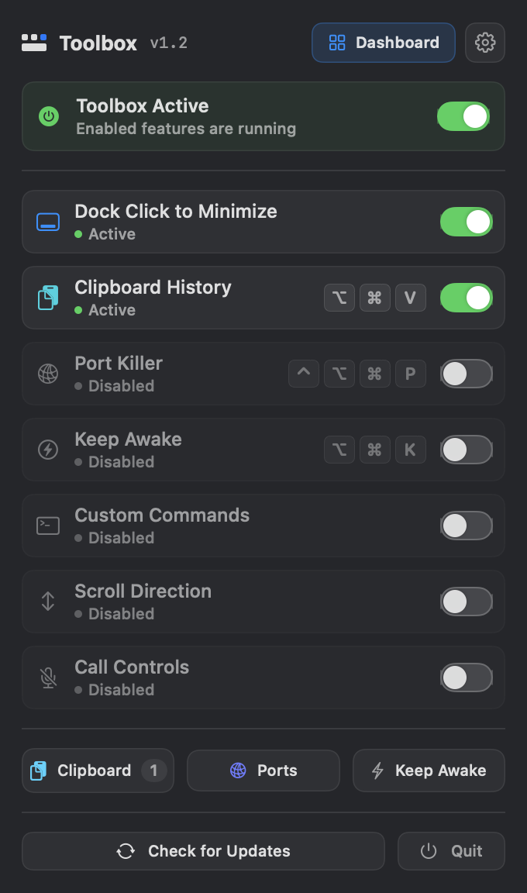

# Toolbox: macOS quality-of-life utilities

Lightweight, native macOS utilities for Dock window toggling, clipboard history, port management, screen OCR (text & QR), call mic/video controls, keyboard-lock mode, display sleep control, independent mouse scroll direction, and global shortcuts.

**[Download .dmg](https://github.com/ssa17/toolbox/releases/latest/download/Toolbox.dmg)** · [Sponsor on GitHub](https://github.com/sponsors/ssa17) · [Support on Ko-fi](https://ko-fi.com/ssa17)


## Install

1. Download the latest **[Toolbox.dmg](https://github.com/ssa17/toolbox/releases/latest/download/Toolbox.dmg)**
2. Open it and drag **Toolbox** into your **Applications** folder
3. Launch Toolbox from Applications

Toolbox checks for updates automatically via Sparkle and installs them in place.

> **Private by design.** Toolbox runs locally on your Mac. Nothing is sent off your machine, password-manager clipboard entries are ignored by default, and Accessibility permission is only requested for features that control windows, paste, or mouse scroll events.

## What you get

- **Dock Click to Minimize:** click the active app's Dock icon to hide its windows cleanly (Windows taskbar style, without cluttering the Dock's minimized tray) and click again to bring them straight back. Supports send-behind, minimize-tray modes, single/double-click, and per-app exclusions.
- **Clipboard History (`⌘ ⌥ V`):** searchable floating clipboard dropdown with keyboard navigation (`↑`/`↓`/`⏎`/`Esc`), `⌘ 1`–`⌘ 9` quick-paste, full-text preview, pinning with custom titles, password-manager filtering, customizable history limits (`1–200`), optional auto-paste, and optional persistence across restarts.
- **Port Killer (`⌃ ⌥ ⌘ P`):** inspect active listening TCP ports, pin favorite dev ports, and stop or force-kill stuck servers in one click.
- **Screen OCR (`⇧ ⌘ 0`):** drag-select any area of the screen to copy unselectable text or decode QR/barcodes with on-device Apple Vision OCR — fast/accurate modes, line-break and toast options, plus a recent-captures list in Settings.
- **Keep Awake (`⌘ ⌥ K`):** reads your Mac's `pmset` display sleep timeout and nudges the cursor just before sleep and/or holds an IOKit power assertion for quick timers (`15m`, `30m`, `1h`, `2h`) or indefinitely.
- **Keyboard Lock:** temporarily lock your keyboard (including media, volume, and brightness keys) and mouse/trackpad input for `10s`–`3m` with a center-screen countdown and `Hold ⌃ ⌥ ⌘ Esc (3s)` emergency unlock.
- **Custom Commands:** bind global hotkeys to shell commands, applications, URLs, or text snippets with optional toast feedback.
- **Scroll Direction:** invert classic notched mouse wheels while leaving Apple trackpads and smooth-scroll mice on your system setting.
- **Call Controls (`⌃ ⌥ ⌘ M` / `⌃ ⌥ ⌘ V`):** unified global Mic and Video shortcuts that mute your system microphone and control FaceTime, Microsoft Teams, Zoom, Slack, Google Meet, Discord, or custom call apps, paired with a draggable floating Mic/Camera status pill, output device cycling, and auto-mute while typing.
- **Menu-bar item & dropdown:** pause or resume all modules at once, toggle and reorder which features or quick actions appear in the menu bar, check Clipboard count or Ports, toggle Keep Awake, and open Dashboard or Settings in one click.
- **Configuration as code:** all settings live in `~/.config/toolbox/config.json` with automatic hot-reload and an in-app JSON editor. Pinned clipboard entries persist in `~/.config/toolbox/pinned_clipboard.json`.

<p align="center">
  
</p>

## Requirements

- macOS 14 (Sonoma) or later, Apple Silicon

## Support

Toolbox is free, private, and open source. If it saves you time, you can support ongoing development via:

- **[GitHub Sponsors](https://github.com/sponsors/ssa17)** (for developers — 0% fees)
- **[Ko-fi](https://ko-fi.com/ssa17)** (Apple Pay, cards, or PayPal — no GitHub account needed)

---

## License

**Toolbox is free to use and free to modify, but not for sale.**

You may use, study, and modify this software for personal or non-commercial purposes. You may distribute modified versions, provided you also distribute them for free and do not charge money for them or bundle them into a paid product.

See [LICENSE](LICENSE) for the full text.

---

## For developers

**Tech stack:** native Swift / SwiftUI / AppKit (`Package.swift`, Apple CommandLineTools or Xcode) with bundled [Sparkle 2](https://sparkle-project.org) for auto-updates.

### Build from source

```bash
./scripts/build-app.sh --fast       # debug build + Developer ID / ad-hoc sign (~2s)
./scripts/build-app.sh --notarize   # release build + Developer ID sign + Notarize & Staple
open ./build/Toolbox.app
```

Built-in CLI checks:

```bash
./build/Toolbox.app/Contents/MacOS/Toolbox --version
./build/Toolbox.app/Contents/MacOS/Toolbox --self-test
./build/Toolbox.app/Contents/MacOS/Toolbox --snapshot-ui .work/snapshots
```

See [EXTENDING.md](EXTENDING.md) to add a new module, [docs/testing.md](docs/testing.md) for the test workflow, and [docs/distribution-guide.md](docs/distribution-guide.md) for DMG packaging and Sparkle releases.

### Project layout

```text
Sources/Toolbox/
├── ToolboxApp.swift          app entry point, CLI flags, single-instance guard
├── Core/                     module registry, config watcher, hotkeys, permissions, Sparkle, self-tests
├── Modules/                  DockMinimize, Clipboard, PortKiller, ScreenOCR, KeepAwake, CleanLock, CustomCommands, ScrollDirection, CallControls
└── UI/                       dashboard, sidebar shell, menu bar popover, settings, JSON editor
scripts/build-app.sh          builds, signs, and notarizes build/Toolbox.app
scripts/make-dmg-bg.mjs       generates the Retina DMG installer background
vendor/fetch-sparkle.sh       fetches pre-built Sparkle 2 framework (gitignored)
fastlane/Fastfile             release pipeline (notarized DMG + Sparkle zip + GitHub Release + appcast)
releases/appcast.xml          Sparkle update feed (served via raw GitHub)
```
