<div align="center">

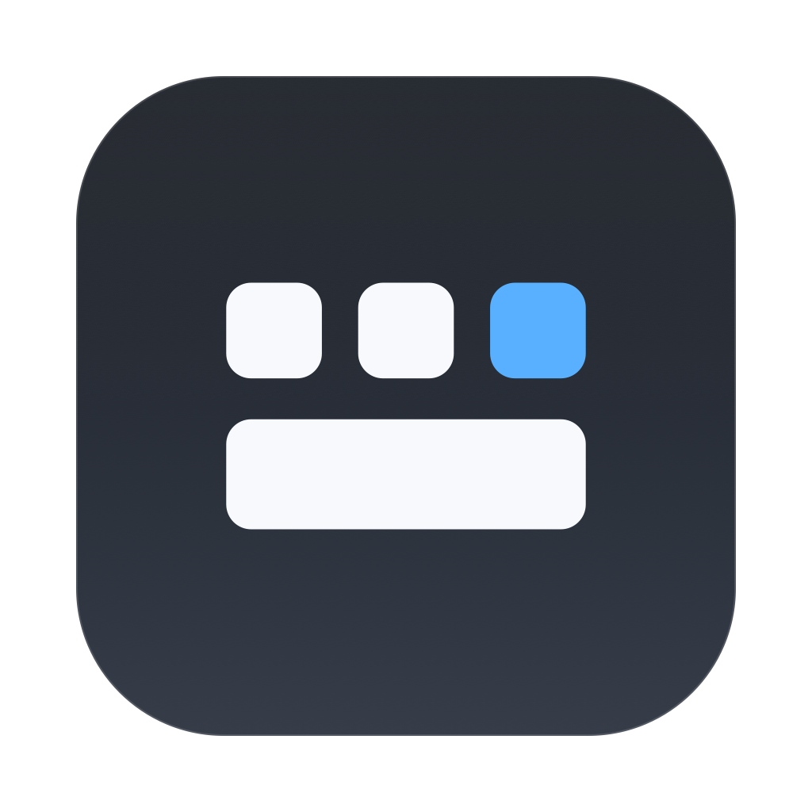

# Toolbox

**Lightweight, native macOS utilities — window snapping, window switching, screenshot annotation & redaction, clipboard history, OCR, call controls, and more in one local app.**

[](https://github.com/ssa17/toolbox/releases/latest)
[](#installation)
[](#for-developers)
[](LICENSE)

<br />

**[⬇ Download Toolbox.dmg](https://github.com/ssa17/toolbox/releases/latest/download/Toolbox.dmg)** &nbsp;·&nbsp; [What's New](CHANGELOG.md) &nbsp;·&nbsp; [Sponsor on GitHub](https://github.com/sponsors/ssa17) &nbsp;·&nbsp; [Support on Ko-fi](https://ko-fi.com/ssa17)

<sub>[Tools](#tools) · [Visual Tour](#visual-tour) · [Shortcuts](#default-shortcuts) · [Install](#installation) · [Privacy & Permissions](#privacy--permissions) · [Configuration](#configuration-as-code) · [Developers](#for-developers)</sub>

<br />

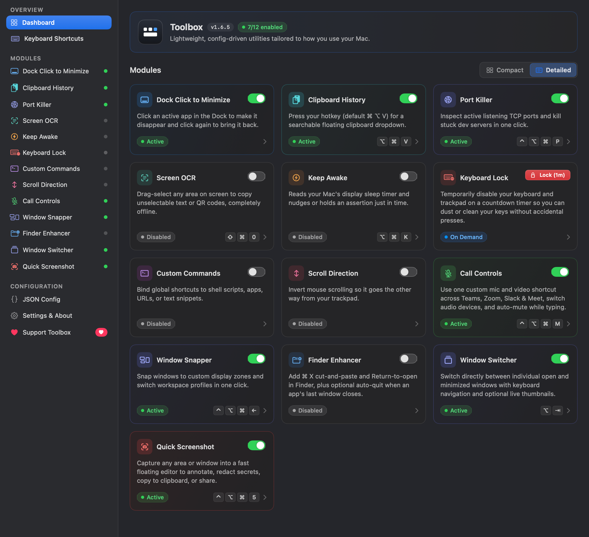

</div>

---

## Why Toolbox?

- **Native & lightweight:** Built in pure Swift, SwiftUI, and AppKit for Apple Silicon — fast startup, crisp dark UI, and zero Electron bloat.
- **Enable only what you need:** Every tool can be turned on or off independently from the Dashboard or menu bar, and paused globally with one switch.
- **Private & offline:** Everything runs locally on your Mac with zero telemetry or cloud accounts. On-device Apple Vision powers OCR and secret redaction.
- **Config as code:** All settings live in `~/.config/toolbox/config.json` with live hot-reload and an in-app JSON editor, plus automatic updates via Sparkle 2.

---

## Tools

### Tools at a Glance

| Category | Tool | Default Shortcut | What it does |
| :--- | :--- | :--- | :--- |
| **Window & Desktop** | **Window Snapper** | `⌃ ⌥ ⌘ ←/→/↑/↓` | Snap windows to magnetic edges, corners, a Top Edge Panel with frosted glass panes, custom per-display grids, and multi-display Workspace Profiles. |
| | **Window Switcher** | `⌥ Tab` | Cycle through individual open, minimized, and hidden-app windows in a thumbnail strip or compact list with `/` filtering and `W`/`M`/`H`/`Q` quick actions. |
| | **Dock Click to Minimize** | *Dock click* | Click an active app's Dock icon to hide its windows cleanly (Windows taskbar style) and click again to bring them straight back. |
| **Capture & Clipboard** | **Quick Screenshot** | `⌃ ⌥ ⌘ 5` | Capture any region or window into a floating editor with arrows, shapes, spotlights, step badges, Beautify frames, Pin on Screen, OCR, and irreversible Auto-Redact. |
| | **Clipboard History** | `⌘ ⌥ V` | Searchable text & image clipboard dropdown with **Pinned** (`⌘ 1`–`⌘ 9`) and **Recent** sections, type filters, previews, and password-manager filtering. |
| | **Screen OCR** | `⇧ ⌘ 0` | Drag-select any screen region to copy unselectable text or decode QR/barcodes completely offline via Apple Vision. |
| **Audio, Input & Focus** | **Call Controls** | `⌃ ⌥ ⌘ M` / `V` | Unified global Mic & Video shortcuts across Teams, Zoom, Slack, Google Meet, Discord & FaceTime, plus a floating pill, auto-mute while typing, and Bluetooth stereo protection. |
| | **Finder Enhancer** | `⌘ X` → `⌘ V` | Move files in Finder with `⌘ X` → `⌘ V`, open with `Return` (or rename with `F2`), and auto-quit allowlisted single-window apps when their last window closes. |
| | **Scroll Direction** | *Mouse wheel* | Invert notched mouse wheel scrolling while keeping Apple trackpads and smooth-scroll mice on your system setting. |
| | **Keep Awake** | `⌘ ⌥ K` | Reads your Mac's `pmset` display sleep timer and nudges the cursor just before sleep and/or holds an IOKit assertion for timed or indefinite sessions. |
| | **Keyboard Lock** | *On demand* | Lock keyboard (including media, volume & brightness keys) and mouse/trackpad for `10s`–`5m` with a countdown HUD and `Hold ⌃ ⌥ ⌘ Esc (3s)` unlock. |
| **Developer & Automation** | **Port Killer** | `⌃ ⌥ ⌘ P` | Inspect active listening TCP ports (including `root` / elevated listeners), pin favorite dev ports, and stop or force-kill stuck servers in one click. |
| | **Shortcuts Hub & Hyper Key** | *Sidebar* | Search, test, and resolve conflicts across all Toolbox shortcuts with a Visual Key Map, plus turn Caps Lock into a dual-role Hyper Key. |
| | **Custom Commands** | *Custom* | Bind global hotkeys to shell scripts, apps, URLs, or text snippets with optional toast feedback and menu-bar visibility. |

### Built-In Polish

- **Menu Bar Popover:** Toggle Toolbox globally, switch individual tools, trigger Clipboard / Port Killer / Keep Awake / Workspace Profiles, and customize tool order.
- **Responsive Window & Navigation:** Shrinks smoothly down to `340×300 pt` with an auto-collapsing sidebar, **Compact / Detailed** Dashboard cards, and back/forward history (`⌘ [` / `⌘ ]`, toolbar arrows, mouse buttons, trackpad swipes).
- **Live Text Scaling:** Switch between **Small**, **Standard**, **Large**, and **Extra Large** typography live across windows, popovers, the JSON editor, and HUDs.

---

## Visual Tour

### Window Snapper & Workspace Profiles

Snap windows effortlessly by dragging or via keyboard shortcuts, then organize multi-monitor setups into one-click profiles:

- **Magnetic Edges, Corners & Grid Overlays:** Edge-to-edge Maximize, Dock-safe bottom edge, smooth glide animations, and `⇧`-hold multi-zone grid snapping with seam spanning.
- **Top Edge Panel & Frosted Glass Panes:** Drag a window near the top edge to pick a layout template, then fill remaining empty zones from frosted glass panes showing live thumbnails (or app icons without Screen Recording).
- **1:1 On-Screen Divider Editor:** Drag zone dividers directly on your screen with live percentage and pixel readouts, saved per display.
- **Multi-Display Workspace Profiles:** Define 1-, 2-, and 3-display layout variants in one profile, preview a dry-run on screen, toggle-Restore your previous layout with the same shortcut, and auto-apply when external monitors connect.

<table>
  <tr>
    <td align="center" width="50%">
      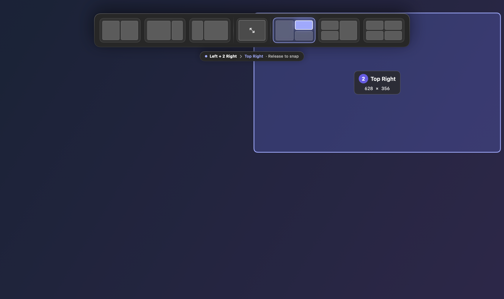<br />
      <sub><b>Top Edge Panel</b> — drop to pick a layout and zone</sub>
    </td>
    <td align="center" width="50%">
      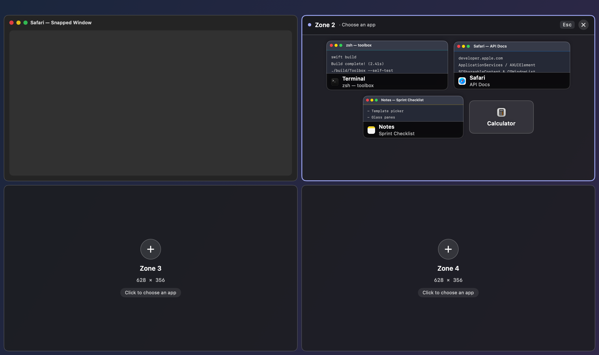<br />
      <sub><b>Frosted Glass Panes</b> — fill empty slots from open windows</sub>
    </td>
  </tr>
  <tr>
    <td align="center" width="50%">
      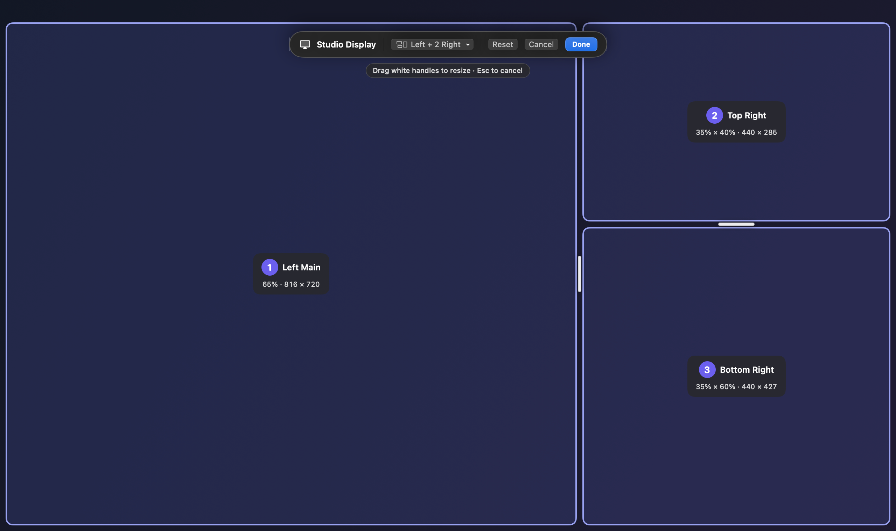<br />
      <sub><b>1:1 Divider Editor</b> — drag handles with live proportions</sub>
    </td>
    <td align="center" width="50%">
      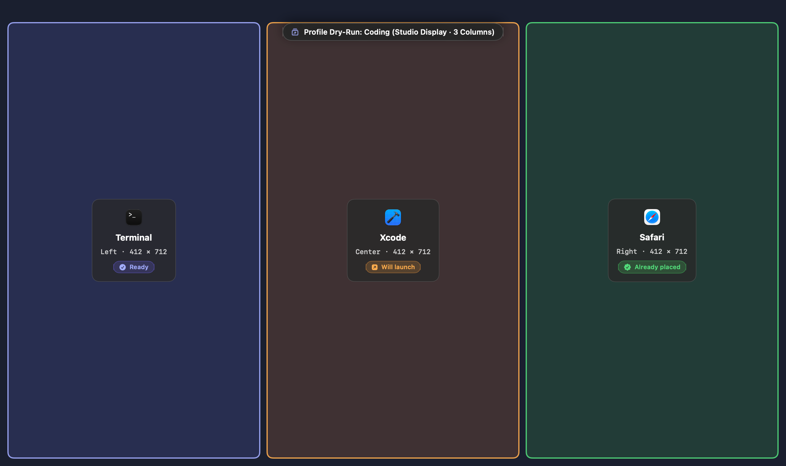<br />
      <sub><b>Workspace Profile Preview</b> — multi-app placement dry-run</sub>
    </td>
  </tr>
</table>

---

### Quick Screenshot & On-Device Auto-Redact

Press `⌃ ⌥ ⌘ 5` to drag-capture a region or press `Space` to snap a window straight into the floating **Quick Editor**:

- **Fast Annotation Tools:** Arrows, rectangles, ellipses, spotlights, freehand/box highlighters, customizable text pills, numbered step badges, and non-destructive crop — each remembering its own defaults.
- **On-Device Auto-Redact & OCR:** Automatically detects API keys, emails, secrets, and recovery codes locally with Apple Vision into a review tray. Choose **Pixelate**, **Blur**, **Solid**, or **Smart Erase** (permanently flattened on export), or copy extracted text in one click.
- **Beautify & Pin on Screen:** Frame captures with gradient backdrops, padding, rounded corners, and shadows, zoom with pinch/scroll, or pin any capture above other windows (`⌘ P`).

<table>
  <tr>
    <td align="center" width="50%">
      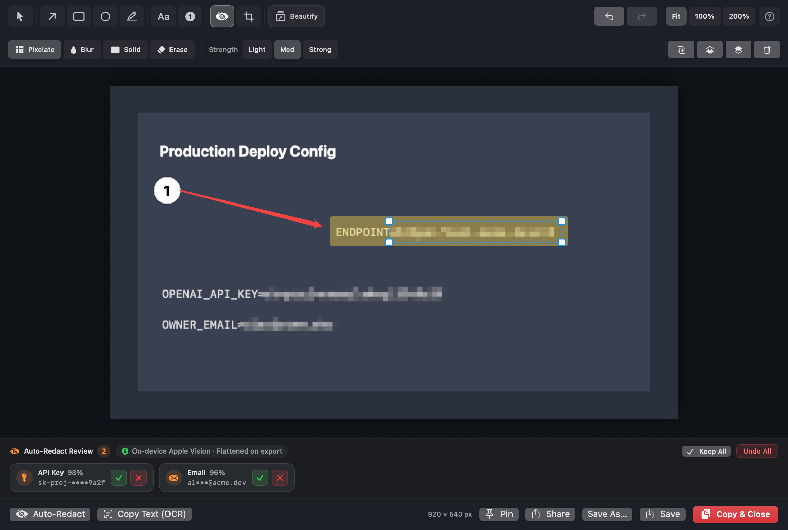<br />
      <sub><b>Quick Editor &amp; Auto-Redact</b> — local Vision detection + pixelate</sub>
    </td>
    <td align="center" width="50%">
      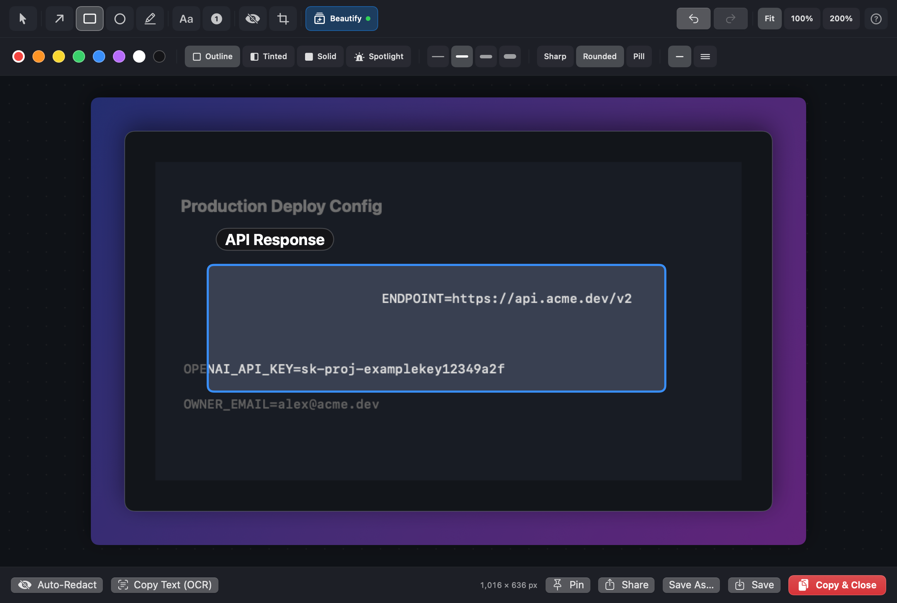<br />
      <sub><b>Beautify &amp; Spotlight</b> — gradient frames, text pills &amp; callouts</sub>
    </td>
  </tr>
</table>

---

### Window Switcher (`⌥ Tab`)

Switch directly between individual windows — including minimized windows and hidden apps — instead of switching whole apps with macOS `⌘ Tab`:

- **Strip or Compact List:** Navigate with `⌥ Tab` / `⌥ ⇧ Tab` or arrow keys, with optional live ScreenCaptureKit thumbnails (or crisp app icons when Screen Recording is off).
- **Type-to-Filter & Quick Actions:** Press `/` to pin the HUD open and filter by window title or app name, or press `W` Close, `M` Minimize/Restore, `H` Hide, and `Q` Quit.

<div align="center">
  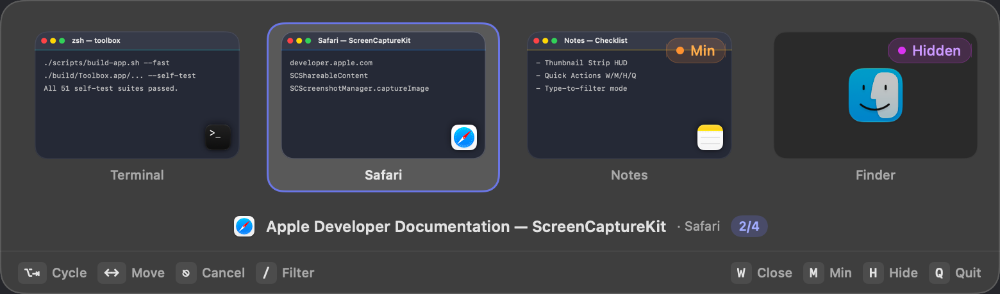
</div>

---

### Clipboard History & Port Killer

Two fast, non-activating floating popovers that appear near your cursor and stay completely out of your way:

<table>
  <tr>
    <td align="center" width="50%">
      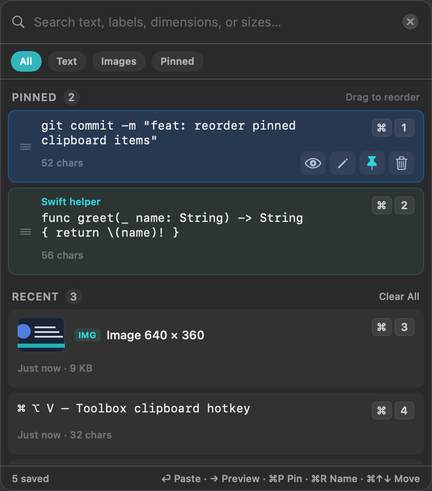<br />
      <sub><b>Clipboard History (<code>⌘ ⌥ V</code>)</b> — pinned quick-paste &amp; filters</sub>
    </td>
    <td align="center" width="50%">
      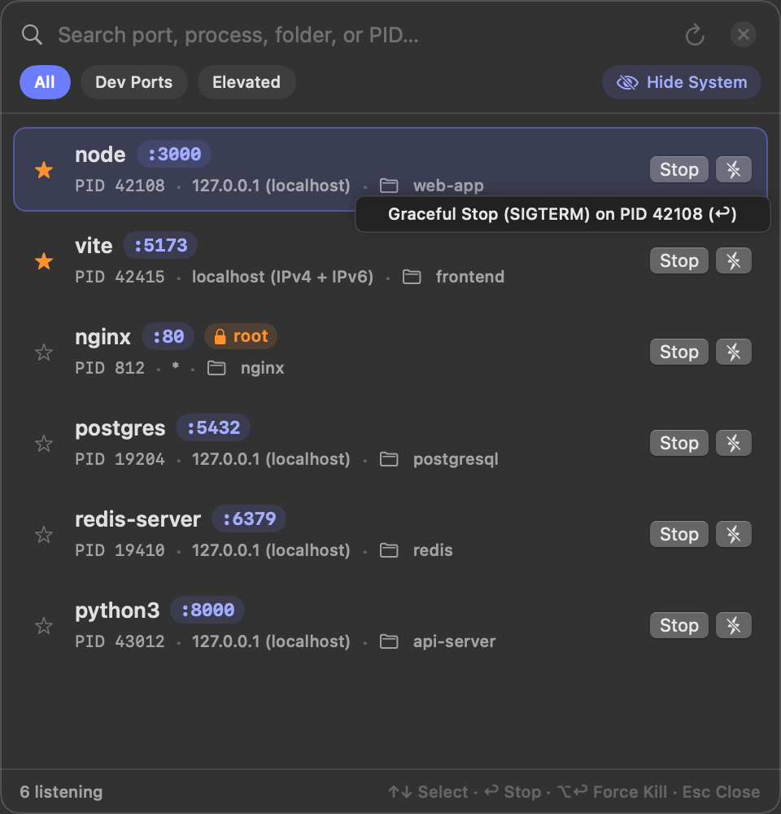<br />
      <sub><b>Port Killer (<code>⌃ ⌥ ⌘ P</code>)</b> — listening TCP ports &amp; one-click stop</sub>
    </td>
  </tr>
</table>

- **Clipboard History (`⌘ ⌥ V`):** Stores text and images locally with **All / Text / Images / Pinned** filters, drag or `⌘ ↑` / `⌘ ↓` pin reordering, custom labels (`⌘ R`), full preview (`→`), optional auto-paste, configurable history limits (`1–200`), and automatic ignoring of password-manager entries.
- **Port Killer (`⌃ ⌥ ⌘ P`):** Surfaces every listening TCP socket (including `root` and other-user listeners that plain `lsof` hides), pins favorite dev ports (`3000`, `5173`, `8000`, `8080`), filters by **All / Dev Ports / Elevated**, and handles macOS Touch ID / password authorization when stopping elevated processes.

---

### Keyboard Shortcuts Hub & Caps Lock Hyper Key

Manage every Toolbox shortcut from one command center in the sidebar:

- **Search, Test & Resolve Conflicts:** Filter by **Active**, **Unassigned**, or **Conflicts**, use **Press Key to Find** to jump straight to any bound key, or inspect available modifier chords in the **Visual Key Map**.
- **Caps Lock Hyper Key:** Turn `Caps Lock` into a dual-role modifier — hold for `⌃ ⌥ ⌘` (**Toolbox Chord**, matching all default Toolbox shortcuts out of the box) or `⌃ ⌥ ⇧ ⌘` (**Classic Hyper**), and quick-tap to toggle Caps Lock or send `Esc`.

<div align="center">
  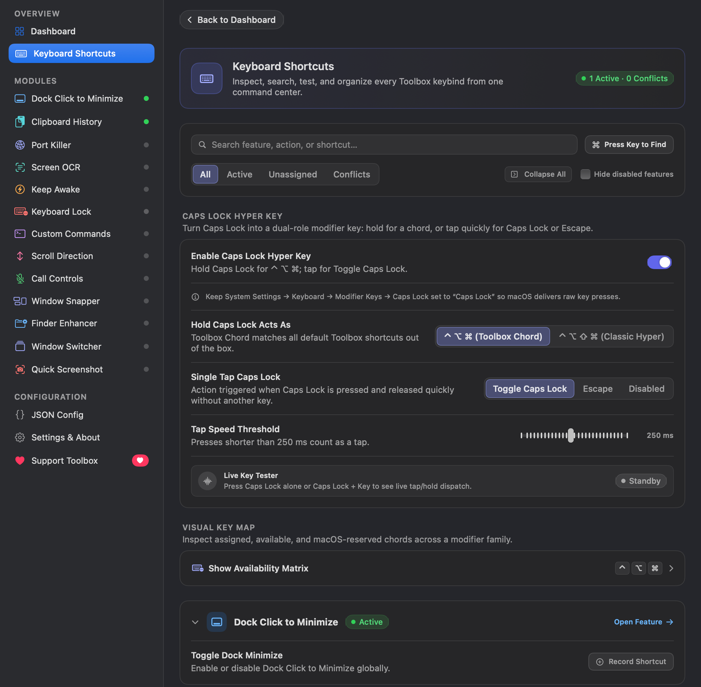
</div>

---

### Menu Bar, Call Controls & Everyday Tools

<table>
  <tr>
    <td align="center" valign="top" width="300">
      
    </td>
    <td valign="top">
      <h4>Menu Bar Popover</h4>
      <ul>
        <li><b>Master Active / Paused Switch:</b> Pause or resume every enabled tool in one click without losing settings.</li>
        <li><b>Quick Triggers &amp; Profiles:</b> Jump to Clipboard, Port Killer, Keep Awake, or apply/restore Workspace Profiles right from the menu bar.</li>
        <li><b>Customizable Layout:</b> Choose which tools and quick actions appear in the popover and drag to reorder them in Settings.</li>
        <li><b>Update Status:</b> Surfaces Sparkle update availability cleanly without modal interruptions.</li>
      </ul>
      <h4>Call Controls &amp; Bluetooth Stereo Protection</h4>
      <p align="center">
        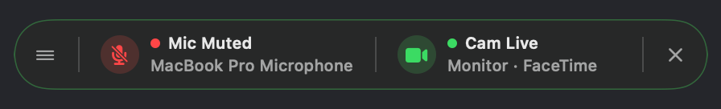
      </p>
      <ul>
        <li><b>Unified Mic &amp; Video Shortcuts (<code>⌃ ⌥ ⌘ M</code> / <code>⌃ ⌥ ⌘ V</code>):</b> Mute macOS hardware input and relay to FaceTime, Microsoft Teams, Zoom, Slack, Google Meet, Discord, or custom call apps.</li>
        <li><b>Bluetooth Headphone Stereo:</b> Keeps AirPods and Bluetooth headsets in high-quality A2DP stereo by routing mic capture to your Mac or USB mic (with one-click <i>Allow Headset Mic</i> override and clear call-app guidance).</li>
        <li><b>Floating Status Pill &amp; Typing Guard:</b> Draggable Mic/Camera pill during active calls, output device cycling, and optional auto-mute while typing.</li>
      </ul>
    </td>
  </tr>
</table>

<table>
  <tr>
    <td valign="top" width="66%">
      <h4>More Built-In Tools</h4>
      <ul>
        <li><b>Dock Click to Minimize:</b> Click an active app's Dock icon to hide its windows without cluttering the Dock tray, or click again to restore. Supports send-behind, minimize-tray, single/double-click, and per-app exclusions.</li>
        <li><b>Finder Enhancer:</b> Move files with <code>⌘ X</code> → <code>⌘ V</code> (using Finder's native Move Item Here with full <code>⌘ Z</code> undo), open with <code>Return</code>, optionally rename with <code>F2</code>, and auto-quit allowlisted apps when their last window closes.</li>
        <li><b>Screen OCR (<code>⇧ ⌘ 0</code>):</b> Drag-select any region to copy text or decode QR/barcodes locally with Apple Vision, fast/accurate modes, line-break preservation, and recent captures in Settings.</li>
        <li><b>Keep Awake (<code>⌘ ⌥ K</code>):</b> Reads your Mac's <code>pmset</code> display sleep timeout and nudges the cursor just in time and/or holds an IOKit assertion (<code>15m</code>, <code>30m</code>, <code>1h</code>, <code>2h</code>, <code>4h</code>, custom, or indefinite).</li>
        <li><b>Scroll Direction:</b> Inverts classic notched mouse wheels while leaving Apple trackpads and smooth-scroll mice on your system setting.</li>
        <li><b>Custom Commands:</b> Bind global hotkeys to shell commands, apps, URLs, or text snippets with optional toast notifications.</li>
      </ul>
    </td>
    <td align="center" width="34%">
      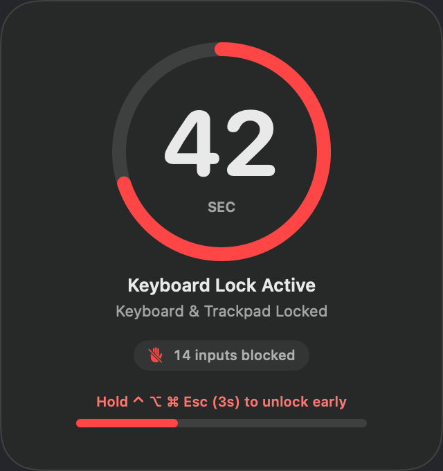<br />
      <sub><b>Keyboard Lock</b> — locks keys, media keys &amp; pointer for <code>10s</code>–<code>5m</code>. Hold <code>⌃ ⌥ ⌘ Esc (3s)</code> to unlock early.</sub>
    </td>
  </tr>
</table>

---

## Default Shortcuts

| Action | Default Shortcut | Tool |
| :--- | :--- | :--- |
| Toggle Clipboard History | `⌘ ⌥ V` | Clipboard History |
| Quick-paste Pinned / Recent item | `⌘ 1` – `⌘ 9` | Clipboard History |
| Toggle Port Killer | `⌃ ⌥ ⌘ P` | Port Killer |
| Capture Quick Screenshot | `⌃ ⌥ ⌘ 5` | Quick Screenshot |
| Capture Screen OCR / QR | `⇧ ⌘ 0` | Screen OCR |
| Toggle Keep Awake | `⌘ ⌥ K` | Keep Awake |
| Toggle Call Mic / Video | `⌃ ⌥ ⌘ M` / `⌃ ⌥ ⌘ V` | Call Controls |
| Switch Open / Minimized Windows | `⌥ Tab` / `⌥ ⇧ Tab` | Window Switcher |
| Emergency Unlock Keyboard Lock | `Hold ⌃ ⌥ ⌘ Esc (3s)` | Keyboard Lock |
| Back / Forward in Toolbox UI | `⌘ [` / `⌘ ]` | Navigation |

<details>
<summary><b>Window Snapper shortcuts</b> (Default Toolbox-safe &amp; Rectangle-style preset)</summary>

| Action | Default (`Toolbox-safe`) | Rectangle Preset |
| :--- | :--- | :--- |
| Left / Right Half | `⌃ ⌥ ⌘ ←` / `⌃ ⌥ ⌘ →` | `⌃ ⌥ ←` / `⌃ ⌥ →` |
| Top / Bottom Half | `⌃ ⌥ ⌘ ↑` / `⌃ ⌥ ⌘ ↓` | `⌃ ⌥ ↑` / `⌃ ⌥ ↓` |
| Top-Left / Top-Right Quarter | `⌃ ⌥ ⌘ 1` / `⌃ ⌥ ⌘ 2` | `⌃ ⌥ U` / `⌃ ⌥ I` |
| Bottom-Left / Bottom-Right Quarter | `⌃ ⌥ ⌘ 3` / `⌃ ⌥ ⌘ 4` | `⌃ ⌥ J` / `⌃ ⌥ K` |
| Maximize / Center | `⌃ ⌥ ⌘ ↩` / `⌃ ⌥ ⌘ C` | `⌃ ⌥ ↩` / `⌃ ⌥ C` |
| Previous / Next Display | `⌃ ⌥ ⌘ [` / `⌃ ⌥ ⌘ ]` | `⌃ ⌥ ⌘ ←` / `⌃ ⌥ ⌘ →` |
| Undo / Restore Pre-Snap | `⌃ ⌥ ⌘ Z` / `⌃ ⌥ ⌘ ⌫` | `⌃ ⌥ ⌘ Z` / `⌃ ⌥ ⌫` |

</details>

<details>
<summary><b>Quick Screenshot editor &amp; Window Switcher keys</b></summary>

- **Quick Screenshot tools:** `S` Select · `A` Arrow · `R` Rectangle · `E` Ellipse · `H` Highlighter · `T` Text · `N` Step Badge · `X` Redact · `C` Crop · `B` Beautify
- **Quick Screenshot actions:** `⌘ P` Pin on Screen · `⌘ C` / `↩` Copy & Close · `⌘ S` Save · `⌘ ⇧ S` Save As · `⌘ Z` / `⌘ ⇧ Z` Undo / Redo · `⌘ D` Duplicate · `⌘ [` / `⌘ ]` Layer Order · `⌘ +` / `⌘ -` / `⌘ 0` Zoom
- **Window Switcher HUD:** `/` Pin & Filter · `W` Close Window · `M` Minimize / Restore · `H` Hide App · `Q` Quit App · `Esc` Cancel

</details>

---

## Installation

**Requirements:** macOS 14 (Sonoma) or later · Apple Silicon

1. Download the latest **[Toolbox.dmg](https://github.com/ssa17/toolbox/releases/latest/download/Toolbox.dmg)** (signed and Apple-notarized).
2. Open the DMG and drag **Toolbox** into your **Applications** folder.
3. Launch **Toolbox** from Applications.

Toolbox checks for updates automatically via [Sparkle 2](https://sparkle-project.org) and installs updates in place.

---

## Privacy & Permissions

> [!NOTE]
> **Private by design.** Toolbox runs 100% locally on your Mac with zero analytics or network telemetry (internet access is only used to check/download Sparkle updates). Password-manager clipboard entries are ignored automatically, and on-device Apple Vision handles OCR and Auto-Redact.

Toolbox only requests macOS permissions for the specific tools you enable:

| Permission | Tools That Use It | Purpose |
| :--- | :--- | :--- |
| **None required** | Clipboard History *(browse/copy)*, Port Killer, Keep Awake, Custom Commands, Call Controls *(hardware mic & audio routing)* | Works immediately on launch. |
| **Accessibility** | Dock Minimize, Window Snapper, Window Switcher, Finder Enhancer, Scroll Direction, Keyboard Lock, Clipboard *(auto-paste)*, Call Controls *(app keybind relay)*, Hyper Key | Read/move windows, observe Dock clicks, and intercept configured shortcuts or mouse wheel events. |
| **Screen Recording** | Quick Screenshot, Screen OCR, *optional* Window Snapper / Window Switcher thumbnails | Capture selected regions/windows locally. Without it, Window Snapper glass panes and Window Switcher gracefully fall back to crisp app icons. |
| **Input Monitoring** | Caps Lock Hyper Key | Listen to raw Caps Lock press/release timing on a dedicated background tap. |

---

## Configuration as Code

All settings live in a clean, human-readable JSON file with automatic hot-reload and an in-app JSON editor:

- **Config file:** `~/.config/toolbox/config.json`
- **Pinned clipboard store:** `~/.config/toolbox/pinned_clipboard.json`
- **Isolated testing / profiles:** Launch with `TOOLBOX_CONFIG_DIR=/path/to/dir` to keep experiments separate from your live config.

---

## Support

Toolbox is free, private, and open source. If it saves you time, you can support ongoing development via:

- **[GitHub Sponsors](https://github.com/sponsors/ssa17)** (0% platform fees)
- **[Ko-fi](https://ko-fi.com/ssa17)** (Apple Pay, cards, or PayPal — no GitHub account needed)

---

## License

**Toolbox is free to use and free to modify, but not for sale.**

You may use, study, and modify this software for personal or non-commercial purposes. You may distribute modified versions, provided you also distribute them for free and do not charge money for them or bundle them into a paid product.

See [LICENSE](LICENSE) for the full text.

---

## For Developers

**Tech stack:** Native Swift 6 / SwiftUI / AppKit (`Package.swift`, Apple CommandLineTools or Xcode) with bundled [Sparkle 2](https://sparkle-project.org) for auto-updates.

### Build & Verify

```bash
./scripts/build-app.sh --fast       # debug build + Developer ID sign
./scripts/build-app.sh --notarize   # release build + Developer ID sign + Notarize & Staple
open ./build/Toolbox.app
```

Built-in CLI diagnostics (automatically isolated from `~/.config/toolbox/`):

```bash
./build/Toolbox.app/Contents/MacOS/Toolbox --version
./build/Toolbox.app/Contents/MacOS/Toolbox --self-test
./build/Toolbox.app/Contents/MacOS/Toolbox --snapshot-ui .work/snapshots
```

- [EXTENDING.md](EXTENDING.md) — Add a new module
- [docs/testing.md](docs/testing.md) — Isolated testing & visual snapshot workflow
- [docs/distribution-guide.md](docs/distribution-guide.md) — Signing, notarization, DMG & Sparkle releases
- [docs/scroll-direction.md](docs/scroll-direction.md) — `CGEventTap` scroll inversion notes
- [docs/feature-roadmap.md](docs/feature-roadmap.md) — Module specs & implementation checklist

### Project Layout

```text
Sources/Toolbox/
├── ToolboxApp.swift          app entry point, CLI flags, single-instance guard
├── Core/                     module registry, config watcher, hotkeys, permissions, Sparkle, self-tests, snapshots
├── Modules/
│   ├── CallControls/         unified mic/video hotkeys, floating pill, typing guard, Bluetooth stereo lock
│   ├── CleanLock/            bounded keyboard & pointer lock + countdown HUD
│   ├── Clipboard/            text & image history, pinning, filters, non-activating popover
│   ├── CustomCommands/       hotkey-bound scripts, apps, URLs & snippets
│   ├── DockMinimize/         Dock click hide/restore & live z-order focus
│   ├── FinderEnhancer/       Finder ⌘ X/V move, Return-to-open, F2 rename & last-window auto-quit
│   ├── HyperKey/             Caps Lock IOKit HID remap & dual-role event tap
│   ├── KeepAwake/            pmset-aware cursor nudge & IOKit power assertions
│   ├── PortKiller/           listening TCP scanner, elevated kill & floating popover
│   ├── QuickScreenshot/      capture editor, annotations, Beautify, Pin on Screen, OCR & Auto-Redact
│   ├── ScreenOCR/            drag-select offline Apple Vision text & QR/barcode capture
│   ├── ScrollDirection/      mouse-wheel-only scroll inversion event tap
│   ├── WindowSnapper/        magnetic snap, Top Edge Panel, glass panes, divider editor & profiles
│   └── WindowSwitcher/       window-level ⌥ Tab switcher HUD with thumbnails & quick actions
└── UI/                       dashboard, shortcuts hub, sidebar shell, menu bar popover, settings, JSON editor
scripts/build-app.sh          builds, signs, and notarizes build/Toolbox.app
scripts/make-dmg-bg.mjs       generates the Retina DMG installer background
vendor/fetch-sparkle.sh       fetches pre-built Sparkle 2 framework (gitignored)
fastlane/Fastfile             release pipeline (notarized DMG + Sparkle zip + GitHub Release + appcast)
releases/appcast.xml          Sparkle update feed (served via raw GitHub)
```
